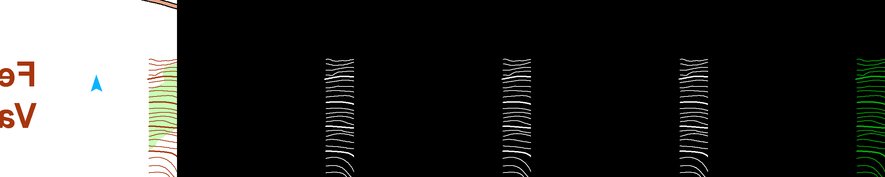

# 定向地图等高线自动提取

**Contour segmentation on TANVOM with U-Net + ResNet18**

基于 PyTorch 的计算机视觉实验：从定向地图 RGB 图块中提取 ISOM 101/102 合并等高线，完成数据检查、训练、像素评估、困难样本分析及独立地图推理。

技术栈：Python · PyTorch · segmentation-models-pytorch · U-Net · ResNet18 · CUDA · AMP

## 实验结果

以下为本次已完成实验的验证集结果，来自 [`reports/baseline_v1_report.json`](reports/baseline_v1_report.json)。指标由整份验证集的像素 TP/FP/FN 汇总计算，并非各图块指标的算术平均。

| 项目 | 结果 |
| --- | ---: |
| 训练 / 验证样本 | 18,880 / 2,664 |
| 输入图块 | 512 × 512 |
| 模型参数量 | 14,328,209 |
| 验证集 Dice / F1 | **0.949115** |
| 验证集 IoU | **0.903158** |
| Precision / Recall | 0.948303 / 0.949929 |
| 最佳 epoch / 总 epoch | 2 / 20 |
| 训练硬件 | RTX 3060 Laptop GPU（6 GB） |
| Batch size / 峰值显存 | 2 / 2,136 MB |
| 训练及结果导出用时 | 约 6.16 小时 |

训练集来自 `burenflue_10000`、`parad_10000`、`varro-haz_10000`，验证集来自 `felsotarkany_10000`，按地图划分。样本数包含官方数据中已有的四种增强变体；训练脚本没有额外增加在线数据增强。相邻切片及增强变体存在相关性，验证样本数不等于独立地图数量。

### 可视化

每张图从左至右为：**原图、标注、预测概率、二值预测、误差图**。误差图中绿色为 TP，红色为 FP，蓝色为 FN。

验证集中 Dice 较高的图块：



验证集中 Dice 最低的图块：


示例为按指标选择的最好/最差样本，不能代表整个数据分布。地图图块来源和署名见 [THIRD_PARTY_NOTICES.md](THIRD_PARTY_NOTICES.md)。完整图块指标见 [`reports/per_tile_metrics.csv`](reports/per_tile_metrics.csv)。

## 方法与实现

- 使用 `segmentation_models_pytorch.Unet`，ResNet18 编码器以 ImageNet 权重初始化，输出单通道 logits。
- RGB 输入除以 255 后使用 ImageNet 均值、标准差归一化；非零标注像素作为前景。
- 损失为 `BCEWithLogitsLoss + soft Dice loss`，优化器为 AdamW，学习率及权重衰减均为 `1e-4`。
- 使用 CUDA、`torch.autocast` 和 `torch.amp.GradScaler` 进行混合精度训练。
- 对 sigmoid 概率使用固定阈值 `0.5`，按验证 Dice 保存最佳模型。
- 分析低召回率、低精确率及稀疏前景样本；9 个验证图块召回率低于 0.5，6 个精确率低于 0.5。

## 环境安装

原实验环境：Windows、Python 3.13.5、PyTorch 2.6.0 + CUDA 12.4。实际软件版本记录在 [`reports/environment.json`](reports/environment.json)。

在仓库根目录打开终端。以下使用已安装的 Python 创建独立环境（Windows PowerShell）：

```powershell
python -m venv .venv
.\.venv\Scripts\Activate.ps1
python -m pip install --upgrade pip
python -m pip install torch==2.6.0 torchvision==0.21.0 --index-url https://download.pytorch.org/whl/cu124
python -m pip install -r requirements.txt
```

CUDA 训练需兼容驱动及 NVIDIA GPU。单图推理和评估脚本支持 `--device cpu`，CPU 速度与数值结果可能不同。原训练脚本要求 CUDA。首次训练会下载 ImageNet 编码器权重。

## 数据准备

从作者发布的 [TANVOM v1（Zenodo）](https://doi.org/10.5281/zenodo.19437536) 获取数据集；本仓库不附带完整数据集。将其解压到下方位置，或修改 `config/baseline_v1.yaml` 中的 `dataset_root`。

```text
data/TANVOM_dataset_V1/
└── processed/tiles_512_s128_v1/
    ├── metadata.csv
    ├── train/images/...
    ├── train/masks/contours/...
    ├── val/images/...
    └── val/masks/contours/...
```

`metadata.csv` 至少包含 `split`、`map_id`、`image_path`、`mask_path`；图像与掩码路径相对于数据集根目录。保留官方地图级划分。脚本检查图像/掩码配对、尺寸、重复路径及训练/验证地图重叠。

## 训练与验证

```powershell
# 数据检查、小规模冒烟训练、完整训练依次执行
python train_contour.py --config config/baseline_v1.yaml --phase audit
python train_contour.py --config config/baseline_v1.yaml --phase smoke
python train_contour.py --config config/baseline_v1.yaml --phase train
```

或使用 `--phase all` 顺序完成以上阶段。输出写入 `outputs/tanvom_baseline_v1/`，包含检查点、训练日志、图块指标和可视化。复现实验耗时较长，本仓库整理发布时未重新执行完整 20 个 epoch。

使用已有检查点重新评估：

```powershell
python evaluate.py --config config/baseline_v1.yaml --checkpoint checkpoints/best_model.pth --output outputs/evaluation
```

## 单图推理

在 [baseline-v1 Release](https://github.com/flaggggg233/tanvom-contour-segmentation/releases/tag/baseline-v1) 下载 `best_model.pth`，保存到 `checkpoints/`。发布权重移除了优化器状态和本机路径，仅用于推理/评估；重新训练会生成完整检查点。SHA-256 见 Release 附件及 [`reports/checkpoint_manifest.json`](reports/checkpoint_manifest.json)。

```powershell
python infer.py --image path/to/map.png --checkpoint checkpoints/best_model.pth --output outputs/prediction
```

输出概率图、二值掩码、叠加图及 `inference.json`。推理保持原始像素尺度；小图右侧/下侧补白，大图使用 512 像素滑窗、默认 384 像素步长并对重叠概率平均。默认自动选择 CUDA/CPU，可显式指定 `--device cpu`。

`infer_oringen_contours.py` 保留原 O-Ringen 对照实验流程，需要另外准备匹配的 manifest 和对照结果，不是单图推理入口。

## 局限与后续方向

- 本项目完成的是**像素级二值分割基线**，没有实现等高线矢量化、拓扑修复或地图重建。
- 当前只有一张地图用于验证；未使用独立测试集，也未进行超参数搜索或测试时增强。
- 极细线条和稀疏前景仍存在漏检、误检及断线问题；像素 Dice/IoU 不能证明线条连通性或矢量质量。
- 在独立 O-Ringen 地图的 20 个图块上进行了推理及人工对照检查，观察到提取效果与 TANVOM 验证集表现有差异；该地图没有像素真值，因此没有独立地图 Dice/IoU，也不能据此量化跨地图泛化能力。见 [`reports/independent_map_test.md`](reports/independent_map_test.md)。
- 后续可增加独立地图标注，进行跨地图定量评估，并分析细线召回率、连通性及拓扑指标。

## 文件结构

```text
train_contour.py             # 原始训练、数据审计和困难样本分析
infer.py                     # 通用单图推理入口
evaluate.py                  # 已有模型验证入口
infer_oringen_contours.py    # 原独立地图对照实验脚本
config/baseline_v1.yaml      # 可移植的实验配置
reports/                    # 已完成实验的指标、日志及报告
assets/                     # 少量验证集可视化
docs/VALIDATION.md          # 本次发布验证范围
```

## 引用与第三方资源

数据集为 Borbás, Péter 与 Troll, Ede 发布的 *TANVOM v1: Dataset for Orienteering Map Vectorization*，DOI：[10.5281/zenodo.19437536](https://doi.org/10.5281/zenodo.19437536)。数据集及衍生图示遵循其 CC BY 4.0 许可，详见 [第三方声明](THIRD_PARTY_NOTICES.md)。

本仓库是基于公开数据集开展的个人基线实验，不是 TANVOM 数据集的官方实现。模型实现使用 [segmentation-models-pytorch](https://github.com/qubvel-org/segmentation_models.pytorch)，训练框架为 [PyTorch](https://pytorch.org/)。
